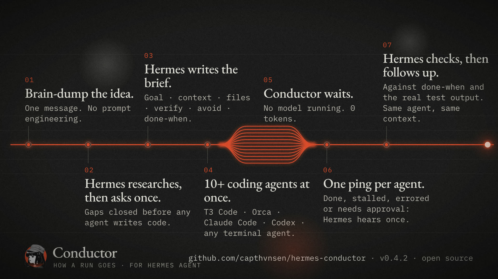
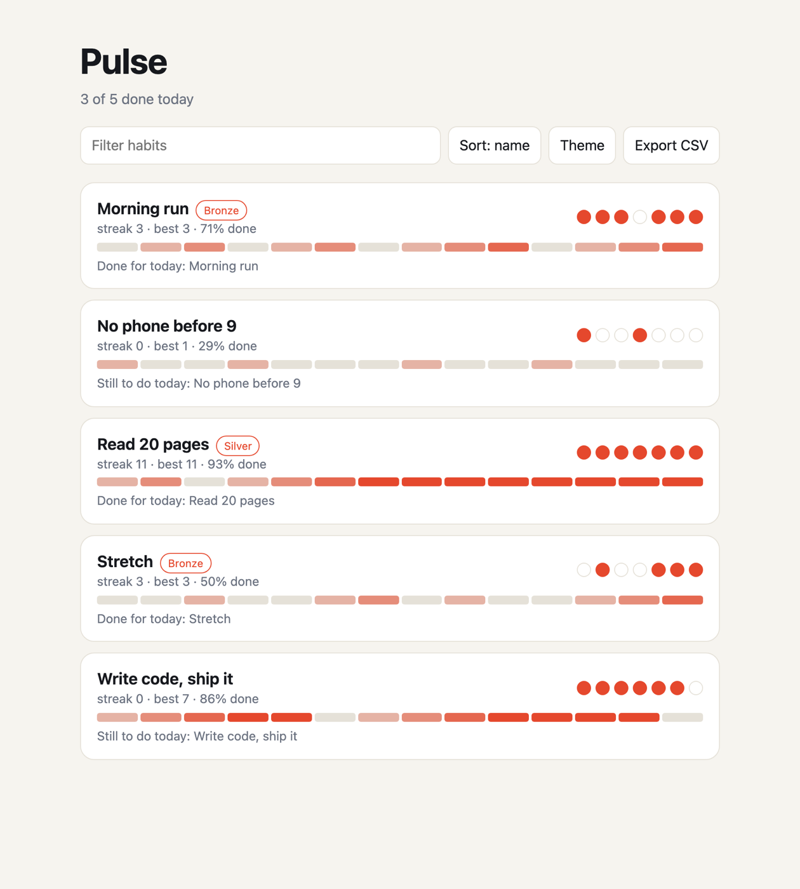

# Conductor


Conductor makes Hermes the CEO of your coding agents. You describe what you want once. Hermes fills the gaps, writes the brief, starts the agents, waits without spending a token, and comes back to you when the work is checked.

## How it works



What each step is made of:

- **Research and interview.** The `brief` skill has Hermes look up what it can, send a cheap read-only scout into the repo, then ask you one round of at most five questions, each with a recommended answer.
- **The brief.** Conductor builds the kickoff from six fields and adds the habits that keep agents on track: the smallest change that works, stop and ask when blocked, a short final answer with the real verify output.
- **Many agents.** Each run is its own agent with its own wait. Hermes starts one run per piece in the same turn; twelve at once is tested. With `lead: true` a single agent acts as CTO and hands pieces to its own subagents.
- **The wait.** No model sits in the wait. Conductor watches the agent and puts one message into the chat that asked.
- **The check.** The `lead` skill has Hermes compare every report with done-when before it tells you the work is done.
- **The follow-up.** T3 Code and Orca runs are steered in place; Claude and Grok continue their last session. Hermes sends only the change, never the rules or the file list again.

It works with any terminal coding agent (Claude Code, Codex, Hermes, Grok, Cursor, OpenCode, Gemini, Qwen, Copilot, Amp, Droid, Kimi, Pi, or any command with a prompt flag), with T3 Code threads, and with Orca terminals. It never adds an approval-bypass flag.

A real run. One message asked Hermes to finish a half-built habit tracker. Hermes read the repo, started twelve agents in T3 Code, one per feature, and reported when all twelve had pinged back and the 24 tests passed:


The app those twelve agents finished:



## Install

```bash
hermes plugins install https://github.com/capthvnsen/hermes-conductor
hermes plugins enable conductor
```

On a messaging gateway, Hermes drops the finish message unless you allow it. In the Hermes config:

```yaml
plugins:
  entries:
    conductor:
      allow_gateway_injection: true
```

Then restart Hermes: the gateway, and the dashboard that serves the desktop app. A process that was already running does not load the plugin.

## Try it

1. `/conductor` shows which agents Hermes can reach.
2. Tell Hermes what you want built and where. It asks what is missing, then starts the agents.
3. Wait. Hermes messages you when an agent needs an approval and when the work is done.

## What it does on your machines

- Runs commands: the coding agent you name, `git status` in the run's folder, and `ssh` and `tmux` when you give a host. Arguments only, never a shell string built from your text.
- Approvals stay with you. An agent that needs one pings once and pings again when it finishes. Orca starts an agent with the permission mode you set in Orca.
- Network: only `ssh` to the hosts you name. No telemetry, no update checks.
- Background work: one wait thread per run inside Hermes, and a detached agent process or tmux window for a CLI run.
- Files: run records and logs in the plugin's Hermes data folder, and event files, exit codes and logs under `~/.conductor` on the machine that runs the agent.
- Credentials: none read or stored. Agents use their own logins.
- It imports one private Hermes function, `gateway.session_context.bound_session_key`, to learn which chat asked, because the plugin API has no call for it. If the import fails, finish messages fall back to the session key Hermes passes to the tool.

## Tests

```bash
uv run --no-project --with pytest python -m pytest tests
```
