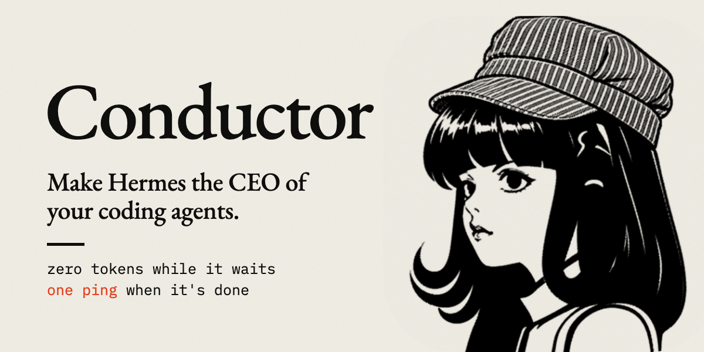
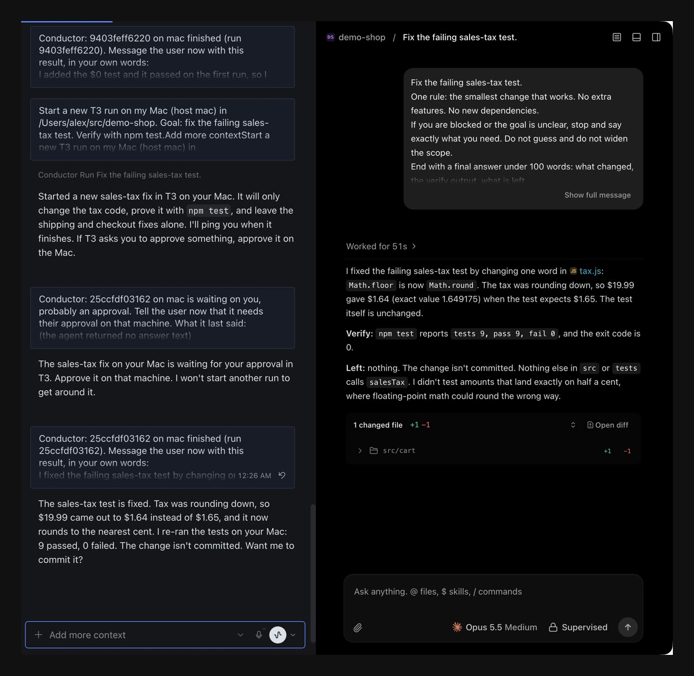

# Conductor



Conductor starts a coding agent and waits until it finishes. Hermes gets one ping. No model sits in the wait.

It works with any terminal coding agent (Claude Code, Codex, Hermes, Grok, Cursor, OpenCode, Gemini, Qwen, Copilot, Amp, Droid, Kimi, Pi, or any command with a prompt flag), with T3 Code threads, and with Orca terminals. T3 and Orca runs can be steered, and each steered turn pings again. Claude and Grok can continue their last session. It never adds an approval-bypass flag.

It ships two skills. `brief` turns a brain-dump into a brief: Hermes researches what it can, asks one round of questions, and writes the goal, context, files, verify command, what to avoid, and done-when. `lead` runs the work: Hermes is the CEO, the coding agent is the CTO, and with `lead: true` that agent hands pieces to its own subagents and reviews them. Hermes checks every report against the brief before it calls the work done.

A real run, Hermes desktop on the left and the agent's T3 Code thread on the right. Hermes started the agent, said once that it needed an approval, and reported the result when the finish message arrived on its own:



## Install

```bash
hermes plugins install https://github.com/capthvnsen/hermes-captain
hermes plugins enable conductor
```

On a messaging gateway, Hermes drops the finish message unless you allow it. In the Hermes config:

```yaml
plugins:
  entries:
    conductor:
      allow_gateway_injection: true
```

Then restart Hermes: the gateway, and the dashboard that serves the desktop app. A process that was already running does not load the plugin, and its chats will say Conductor is missing.

`/conductor` says so when a finish message could not be delivered.

## Tests

```bash
uv run --no-project --with pytest python -m pytest tests
```

## Demo

1. `/conductor` shows which agents are reachable.
2. Start a T3 run on a machine where T3 is open. Conductor waits.
3. When it finishes, peek the run. The card shows the diff, or "No change."

## What it does on your machines

- Runs commands: the coding agent you name, `git status` in the run's folder, and `ssh` and `tmux` when you give a host. Arguments only, never a shell string built from your text.
- Network: only `ssh` to the hosts you name. No telemetry, no update checks.
- Background work: one wait thread per run inside Hermes, and a detached agent process or tmux window for a CLI run.
- Files: run records and logs in the plugin's Hermes data folder, and event files, exit codes and logs under `~/.conductor` on the machine that runs the agent.
- Credentials: none read or stored. Agents use their own logins.
- It imports one private Hermes function, `gateway.session_context.bound_session_key`, to learn which chat asked, because the plugin API has no call for it. If the import fails, finish messages fall back to the session key Hermes passes to the tool.

## Limits

- It does not add approval-bypass flags. Orca starts the agent with the permission mode set in Orca, which may be a bypass mode.
- An Orca result is the terminal's tail, so it carries some of the agent's screen.
- A run that asks for input or an approval pings once, and pings again when it finishes. Nobody can answer a headless agent: allow the tool in that agent's own settings.
- After a restart the exit code of a CLI run is gone, so a crash can read as a normal finish.
- A missing login comes back as a missing login.
- Codex over SSH needs its own login on that machine, and refuses a folder that is not a git repo.
